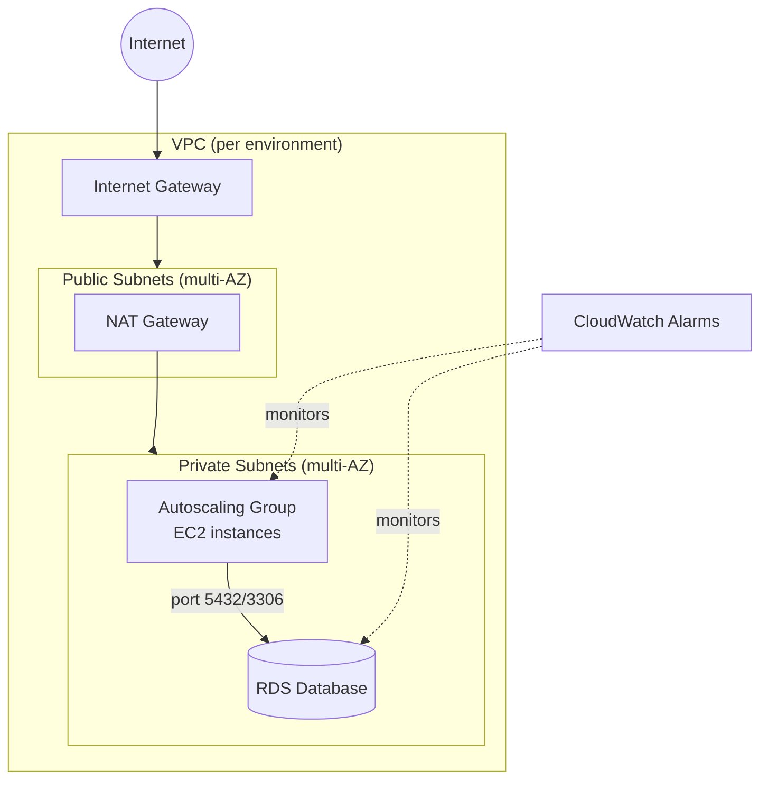

# Multi-Environment AWS Infrastructure (Terraform)

Reusable Terraform modules that provision the same architecture — networking,
compute, and a database — across three isolated environments: `dev`,
`staging`, and `prod`. Each environment is sized differently through its own
`.tfvars` file; the module code itself never changes between environments.

## Architecture



Each environment's compute instances live in private subnets and reach the
internet only via a NAT gateway; the database is never publicly accessible
and only accepts connections from the compute tier's security group.

## Directory structure

```
.
├── modules/
│   ├── networking/    # VPC, public/private subnets, IGW, NAT, route tables
│   ├── compute/        # Launch template + autoscaling group + security group
│   ├── database/       # RDS instance in private subnets + security group
│   └── monitoring/     # CloudWatch alarms for the ASG and RDS (bonus)
├── bootstrap/
│   └── state-backend/  # One-time: creates the S3 bucket + DynamoDB table
│                         used as remote state backend for every environment
├── environments/
│   ├── dev/
│   ├── staging/
│   └── prod/
└── .github/workflows/
    └── terraform.yml    # plan on PR, apply on merge to main (bonus)
```

## Module reference

### `modules/networking`

| Input | Type | Description |
|---|---|---|
| `project_name` | string | Prefix used in resource names/tags |
| `environment` | string | `dev` / `staging` / `prod` (validated) |
| `vpc_cidr` | string | CIDR block for the VPC (validated) |
| `azs` | list(string) | AZs to spread subnets across (min 2, validated) |
| `public_subnet_cidrs` | list(string) | One CIDR per AZ |
| `private_subnet_cidrs` | list(string) | One CIDR per AZ |
| `single_nat_gateway` | bool | Use 1 shared NAT instead of 1 per AZ (cheaper, less resilient) |
| `common_tags` | map(string) | Extra tags merged onto every resource |

Outputs: `vpc_id`, `vpc_cidr`, `public_subnet_ids` / `private_subnet_ids`
(maps keyed by AZ), `public_subnet_ids_list` / `private_subnet_ids_list`
(flat lists), `nat_gateway_ids`, `internet_gateway_id`.

### `modules/compute`

| Input | Type | Description |
|---|---|---|
| `vpc_id`, `vpc_cidr`, `subnet_ids` | — | Wired from the networking module's outputs |
| `ami_id` | string | AMI for the launch template |
| `instance_type` | string | Validated against `xxx.yyy` shape |
| `min_size` / `max_size` / `desired_capacity` | number | ASG sizing |
| `allowed_ssh_cidr_blocks` | list(string) | Leave empty to disable SSH entirely |

Outputs: `autoscaling_group_id`, `autoscaling_group_name`,
`launch_template_id`, `security_group_id`.

### `modules/database`

| Input | Type | Description |
|---|---|---|
| `private_subnet_ids` | list(string) | Must span ≥2 AZs (validated) |
| `allowed_security_group_ids` | list(string) | Only these SGs can reach the DB (validated non-empty) |
| `engine` | string | `postgres` or `mysql` (validated) |
| `instance_class` | string | Must start with `db.` (validated) |
| `allocated_storage` | number | Must be ≥20 GB (validated) |
| `password` | string | `sensitive = true` — never printed in plan/apply output |
| `multi_az`, `deletion_protection` | bool | Set `true` for staging/prod |

Outputs: `db_instance_id`, `db_instance_endpoint`, `db_instance_address`,
`db_security_group_id`.

### `modules/monitoring` (bonus)

CloudWatch alarms for ASG CPU, RDS CPU, and RDS free storage. Takes the
compute and database modules' outputs plus an optional list of
`alarm_actions` (e.g. an SNS topic ARN) to notify.

## Tagging strategy

Every module merges the same three tags onto every resource it creates,
plus whatever the environment passes in via `common_tags`:

```hcl
locals {
  tags = merge(var.common_tags, {
    Environment = var.environment
    Project     = var.project_name
    ManagedBy   = "terraform"
  })
}
```

Individual resources add their own `Name` tag on top of this shared set.

## Setup instructions

### 1. Bootstrap the remote state backend (one time only)

```bash
cd bootstrap/state-backend
terraform init
terraform apply -var="state_bucket_name=your-globally-unique-bucket-name"
```

Note the `state_bucket_name` and `lock_table_name` outputs, then paste the
bucket name into `bucket = "..."` in each environment's `backend.tf`
(currently a `REPLACE-WITH-YOUR-STATE-BUCKET-NAME` placeholder).

### 2. Authenticate to AWS

```bash
aws sso login --profile your-profile
export AWS_PROFILE=your-profile
```

### 3. Deploy an environment

```bash
cd environments/dev
terraform init
terraform fmt -check -recursive
terraform validate
terraform plan  -var-file="dev.tfvars"
terraform apply -var-file="dev.tfvars"
```

Repeat with `staging/staging.tfvars` and `prod/prod.tfvars` for the other
two environments — same commands, same module code, different sizing.

### 4. Secrets

`db_password` in the sample `.tfvars` files is a placeholder. Don't commit
real database passwords to version control — pass them via
`TF_VAR_db_password` or a secrets manager (AWS Secrets Manager / SSM
Parameter Store) instead, and keep any `.tfvars` file with a real secret out
of git (see `.gitignore`).

## CI/CD (bonus)

`.github/workflows/terraform.yml` runs `fmt -check`, `validate`, and `plan`
for all three environments on every pull request, and runs `apply` for all
three (one at a time) on merge to `main`. It expects an `AWS_ROLE_ARN`
repository secret set up for OIDC-based GitHub Actions → AWS authentication.

## Environment sizing at a glance

| | dev | staging | prod |
|---|---|---|---|
| AZs | 2 | 2 | 3 |
| NAT gateways | 1 (shared) | 1 per AZ | 1 per AZ |
| Instance type | t3.micro | t3.small | m5.large |
| ASG size (min/max) | 1 / 2 | 2 / 4 | 3 / 6 |
| DB instance class | db.t3.micro | db.t3.small | db.m5.large |
| DB storage | 20 GB | 50 GB | 200 GB |
| Multi-AZ database | no | no | yes |
| DB deletion protection | no | no | yes |
